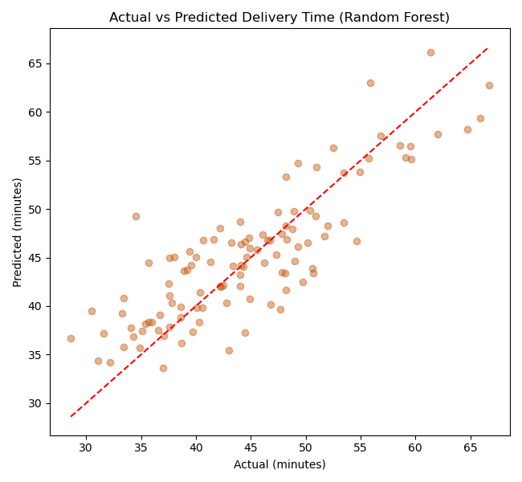
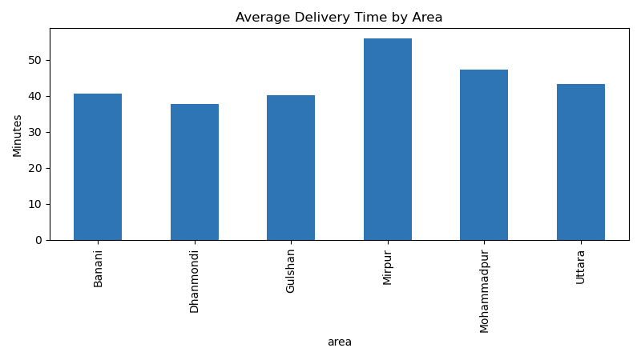
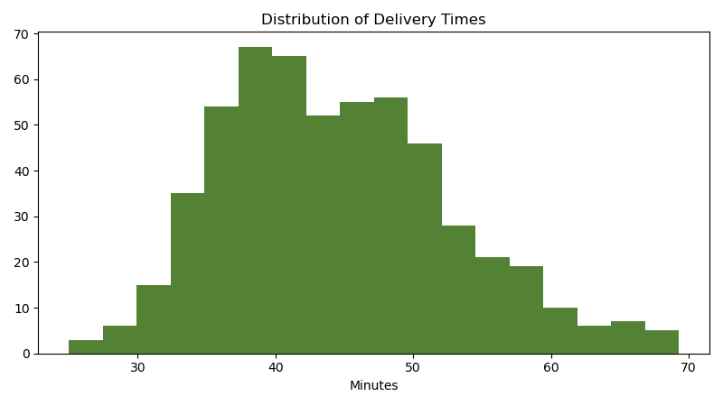
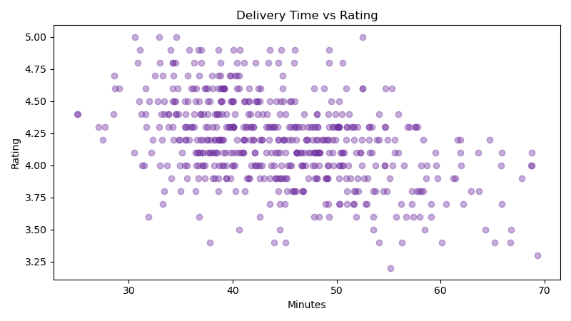
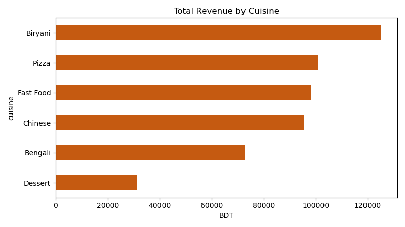

# 🍔 Online Food Delivery Analysis

Analyzing 550 food delivery orders — cuisines, delivery times, ratings and revenue by area.

A complete beginner-friendly Data Science project built with **Python, Pandas, NumPy, Matplotlib and scikit-learn**.
The dataset (550 orders) is synthetic — generated with a fixed NumPy seed so anyone can reproduce it exactly.

## What's inside
- `src/generate_dataset.py` — creates the dataset in `data/`
- `src/analysis.py` — full analysis: summary tables, charts and insights
- `src/ml_model.py` — Machine Learning: trains and compares 2 prediction models
- `online-food-delivery-analysis.ipynb` — Jupyter notebook version of the analysis
- `outputs/charts/` — 4 charts · `outputs/tables/` — 5 summary tables · `outputs/insights.md` — key findings
- `PROJECT_GUIDE.md` — a full beginner-friendly explanation of everything in this project

## How to run
```bash
pip install -r requirements.txt
python src/generate_dataset.py
python src/analysis.py
```

## Dataset columns
| Column | Meaning |
|---|---|
| date | Order date |
| cuisine | Cuisine type |
| area | Delivery area |
| items | Number of items |
| order_value_bdt | Order value in BDT |
| delivery_time_min | Delivery time in minutes |
| discount_pct | Discount percentage |
| is_weekend | 1 if weekend, 0 if weekday |
| rating | Customer rating (1–5) |

# Key Insights — Online Food Delivery Analysis

- Dataset: 550 orders, total revenue **523,572 BDT**.
- Top cuisine by revenue: **Biryani**.
- Slowest delivery area: **Mirpur** (55.9 minutes on average).
- Correlation between delivery time and rating: **-0.43** (slower delivery, lower rating).
- Average order value on weekends: **968 BDT** vs weekdays **946 BDT**.


## Machine Learning — prediction model
Predict the delivery time (`delivery_time_min`) from items, order value, discount, weekend, cuisine and area.

| Model | R² / Accuracy | RMSE |
|---|---|---|
| Linear Regression | 0.802 | 3.62 minutes |
| Random Forest | 0.713 | 4.36 minutes |

**Best model: Linear Regression.** Linear Regression predicts delivery time within about **3.6 minutes** on average (R² = 0.802) — delivery time here grows almost linearly with area distance and item count.

Run it yourself: `python src/ml_model.py` (needs scikit-learn, already in `requirements.txt`).
Results are saved in `outputs/tables/model_results.csv`.



## Charts




